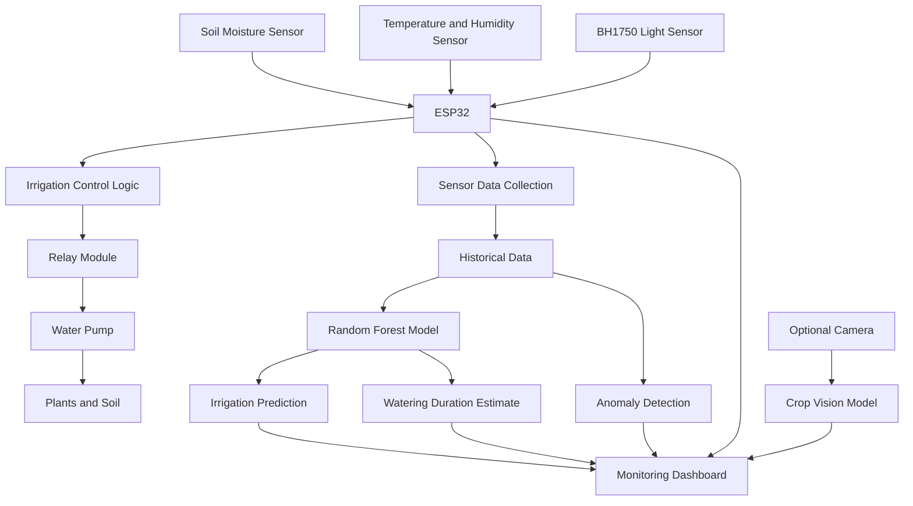

# AI-Based Terrace Irrigation System 🌱

**An IoT-enabled, AI-assisted smart irrigation and terrace crop-monitoring framework.**

## Overview

The AI-Based Terrace Irrigation System combines environmental sensing, automated water delivery, and machine learning to support efficient terrace gardening.

An ESP32 collects soil and environmental measurements, while a relay controls the irrigation pump. Sensor readings and historical irrigation data can be analyzed by machine-learning models to predict irrigation requirements, estimate watering duration, and identify abnormal system behaviour.

The system is designed as a general, crop-configurable framework. Individual crops can be used for demonstrations and model training without restricting the architecture to a single crop.

## Key Features

- **Soil-moisture monitoring:** Measures soil moisture to help determine irrigation requirements.
- **Environmental monitoring:** Collects temperature and relative humidity.
- **Light monitoring:** Uses a BH1750 sensor to measure ambient illuminance.
- **Automatic irrigation:** Controls a water pump through a relay based on configured irrigation logic.
- **AI-based irrigation prediction:** Uses historical and current sensor measurements to estimate whether irrigation is needed.
- **Watering-duration estimation:** Predicts an appropriate watering duration using available sensor and irrigation history.
- **Anomaly detection:** Identifies unusual conditions, such as a running pump without the expected increase in soil moisture.
- **Crop-monitoring extension:** Supports a potential camera-based module for fruit detection, counting, and maturity classification.
- **Extensible architecture:** Allows crop-specific calibration and future integration of additional sensing and analytical modules.

## System Architecture

The ESP32 handles sensor acquisition and pump control. Machine-learning models provide predictions and analytical outputs, while a monitoring interface can present system status and historical data. AI outputs should not bypass independent pump-safety limits.

## Hardware Components

| Component | Purpose |
|---|---|
| ESP32 development board | Sensor acquisition, connectivity, and control |
| Soil-moisture sensor | Estimates soil moisture |
| Temperature and humidity sensor | Measures environmental conditions |
| BH1750 light sensor | Measures ambient illuminance in lux |
| Relay module | Switches the irrigation pump |
| Water pump | Delivers water to plants |
| Water reservoir and tubing | Stores and distributes irrigation water |
| Optional camera | Captures plant or fruit images for visual analysis |

## Technology Stack

| Layer | Technology |
|---|---|
| Embedded controller | ESP32 |
| Firmware | C++ / Arduino framework |
| Development environment | VS Code / PlatformIO, if used in the current build |
| Sensor communication | GPIO and I²C, depending on the sensor |
| Machine learning | Random Forest |
| Data processing | Python, where applicable |
| Visualization | Browser-based dashboard or another configured interface |
| Computer vision | Optional crop-specific image-classification or detection model |

## Irrigation Workflow

1. Read soil-moisture and environmental sensor values.
2. Validate sensor readings and identify invalid or missing measurements.
3. Evaluate the configured irrigation conditions.
4. Apply the pump-control rules and safety limits.
5. Record sensor values, pump state, and irrigation duration.
6. Use historical data to generate irrigation predictions and watering-duration estimates.
7. Compare expected and observed responses to identify possible anomalies.
8. Present current conditions and analytical results through the monitoring interface.

## AI and Machine-Learning Modules

### 1. Irrigation Prediction

A Random Forest classifier can estimate whether irrigation is required using features such as:

- Soil-moisture readings and recent trends
- Temperature and humidity
- Ambient light intensity
- Time of day
- Previous irrigation events
- Previous watering duration

The output can be an irrigation recommendation or a binary prediction, depending on the model design.

### 2. Watering-Duration Estimation

A regression model can estimate watering duration from sensor measurements, crop requirements, and historical irrigation outcomes.

The estimate should be constrained by configured maximum watering times and other safety conditions. The duration model should be trained using suitable reference labels rather than arbitrary assumptions.

### 3. Anomaly Detection

The system can flag potentially abnormal situations, including:

- Pump operating without the expected soil-moisture response
- Implausible or disconnected sensor readings
- Unusually long irrigation cycles
- Unexpected changes in soil moisture

These conditions indicate possible faults or unusual behaviour and require further investigation.

### 4. Optional Computer Vision

A future vision module can analyze plant images to detect or count fruits and classify maturity stages. Its classes and training requirements will depend on the selected crop and the available dataset.

## Dataset Strategy

| Dataset | Purpose |
|---|---|
| Sensor time series | Analyze soil and environmental changes |
| Irrigation-event history | Record pump activation, duration, and observed response |
| Irrigation labels | Train and evaluate the irrigation prediction model |
| Watering-duration records | Train and evaluate duration estimation |
| Normal and abnormal scenarios | Evaluate anomaly detection |
| Plant or fruit images | Train and evaluate optional computer-vision models |

Sensor datasets should contain timestamps, units, calibration details, pump state, and relevant irrigation-event information. Use chronological train/test splits for time-series prediction to reduce data leakage.

## Safety and Limitations

- Soil-moisture readings depend on sensor placement, soil composition, and calibration.
- Ambient light measurements alone do not directly measure plant water requirements.
- Temperature, humidity, and moisture readings should be interpreted in the context of the selected crop.
- Watering-duration predictions depend on reliable historical data and should not be treated as guaranteed optimal values.
- Pump operation should have independent time limits and suitable electrical protection.
- An anomaly alert does not establish the exact cause of a fault.
- Optional fruit detection or maturity classification requires representative labelled images.

## Future Work

- Collect longer-duration sensor and irrigation datasets.
- Evaluate irrigation prediction against measured outcomes.
- Improve watering-duration estimates using crop and soil characteristics.
- Add plant-health monitoring through computer vision.
- Explore crop-specific profiles while retaining a general system architecture.
- Improve dashboard analytics, historical graphs, and notifications.
- Evaluate water-use efficiency against a documented baseline.

## Project Status

The system is intended to combine ESP32-based environmental monitoring, automated irrigation, and AI-assisted decision support.

The implementation status of the dashboard, trained models, duration prediction, anomaly detection, and optional computer vision should be updated according to the verified source code and experimental results.

---

**Goal:** Smarter irrigation, better monitoring, and more informed terrace gardening through IoT and AI.
